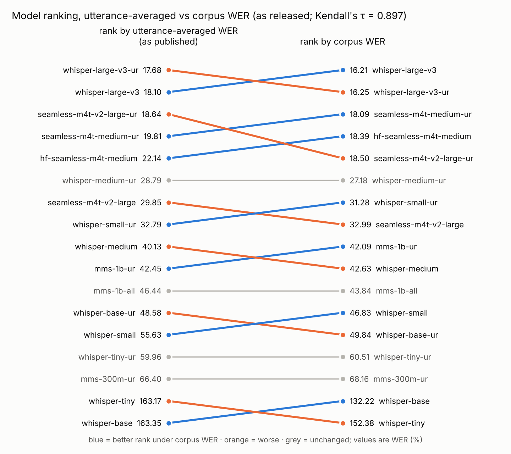
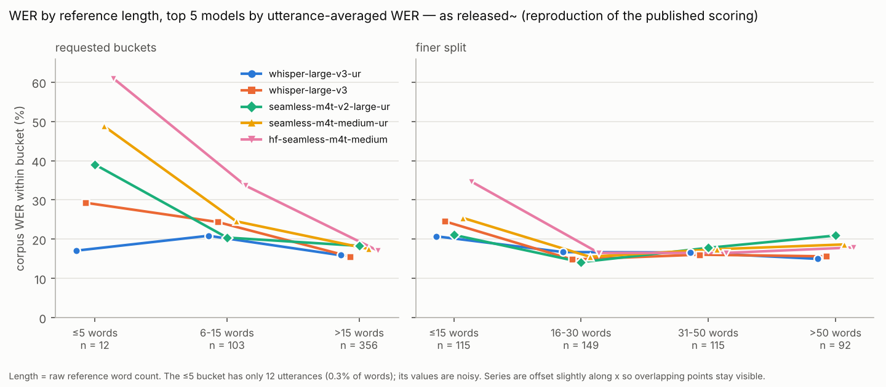

# Re-evaluation of the WER We Stand conversational outputs

This folder holds the aggregate results of `src/reeval_wws.py`. It rescores the
released hypotheses of *WER We Stand: Benchmarking Urdu ASR Models* (Arif et al.,
COLING 2025, arXiv:2409.11252): 17 models × 471 utterances of the conversational
set `urdu-asr/csalt-voice`.

| file | committed | contents |
|---|---|---|
| `reeval_table.csv` | yes | every subset × condition × metric × model: value, 95% CI, rank, Kendall's τ, n |
| `reeval_table.md` | yes | the same, as readable tables |
| `csalt_voice_refs.json` | **no** | cached references (dataset text; not ours to redistribute) |
| `reeval_per_utt.csv` | **no** | per-utterance errors with normalized reference/hypothesis text |
| `reeval_codeswitch_flags.csv` | **no** | per-utterance detector method, with reference text |
| `reeval_meta.json` | no | provenance (also listed below) |
| `reeval_pairwise.{csv,md}` | yes | paired bootstrap of adjacent-model differences (finding 1) |
| `reeval_length_buckets.{csv,md}` | yes | WER/CER by reference-length bucket (finding 2) |
| `reeval_cs_by_length.{csv,md}` | yes | code-switch flag vs length (finding 3) |
| `figures/*.png` | yes | figures built from the committed tables (`src/make_figures.py`) |
| `RUNS.md` | yes | run log: commit, command, provenance, outputs (no reference text) |

## Reproduce

```bash
git clone https://github.com/sameearif/WER-We-Stand external/WER-We-Stand
python src/reeval_wws.py --wws-dir external/WER-We-Stand --out-dir results
python src/reeval_analysis.py --results-dir results   # follow-up analyses (~4–5 s)
```

`reeval_wws.py` takes about 25 s on CPU (run of 2026-11-20, logged
retrospectively in `RUNS.md`). Provenance of the committed tables:

- WER-We-Stand repo commit `9dd7f4d0580a608e53942916a37d4d417328b1b6`
- `urdu-asr/csalt-voice` revision `6f0c4fdeea94c77b4b64c4b88d5887e087566a5f`.
  As of 2026-11-20 this was the only dataset in the `urdu-asr` org (Hugging
  Face API `GET /api/datasets?author=urdu-asr`, queried that day). It has a single `validation`
  split with 471 rows.
- Bootstrap: 1000 resamples of utterances, seed 42. The same resampled index sets
  are used for every model and condition (paired).

## How references were loaded

WWS `src/utils.py::prepare_dataset` concatenates `train`+`test` **only if** a
`train` split exists. Otherwise it uses `validation`, and failing that, `test`.
`csalt-voice` has only `validation`, so no concatenation applies. The script
copies this branching exactly, logs which branch it took, and asserts 471
aligned pairs for every model.

## Conditions

| name | reference | hypothesis |
|---|---|---|
| `as_released~` | raw | WWS `compute_wer_csalt` cleanup (see below) |
| `raw` | raw | raw (whitespace tokenisation only) |
| `N1_unicode` … `N8_latin_drop` | same normalizer as hypothesis | cumulative steps of `src/normalize_urdu.py`, each starting with disfluency-tag removal |
| `N7+hamza_merge` | same as hypothesis | N7 + legacy آ→ا, ئ→ی, ؤ→و merge (ablation) |

The cumulative steps are:

- N1: drop `#…` disfluency tags + NFC + zero-width removal (tag removal is
  the first step of every N-condition)
- N2: punctuation removal
- N3: lowercase Latin
- N4: Arabic→Urdu confusables
- N5: strip diacritics
- N6: digits→ASCII
- N7: digits→Urdu words (Latin tokens kept)
- N8: drop Latin tokens

### `as_released~` and the missing `chars.json`

`compute_wer_csalt` keeps only the hypothesis characters listed in `src/chars.json`.
That file is not in the WER-We-Stand repository at any commit. The script accepts
it via `--chars-json`. Without it, the script uses the 44-character inventory of
the 471 references as a stand-in, and the `~` suffix marks this. With the
stand-in, all 17 utterance-averaged WERs fall between 0.20 points below and 0.00
points above the paper's Table 3 (all within 0.20). The model ranking is
identical to the paper's.

## Normalization: paper text and released code

Paper, §4 "Experimental Design", p. 4 (arXiv:2409.11252):

> "Before conducting the evaluations, we normalize both the ground truth and the
> model predictions. This involves removing punctuation and disfluencies."

Released code, `src/wer.py` at commit `9dd7f4d`, lines 37–43
(`compute_wer_csalt`):

```python
    for i, item in enumerate(transcriptions):
        new_item = ""
        for c in item:
            if c in chars:
                new_item += c
        new_item = re.sub(r'#\S+', '', new_item)
        error += wer(dataset[i]["transcription"], " ".join(new_item.split()))
```

In these lines, the character filter, `#\S+` removal and whitespace collapsing
are applied to the model output (`item`), in that order, so the `#\S+`
pattern only matches if `#` is in `chars.json`. With our stand-in inventory `#`
is not, so the pattern does nothing. The character filter removes the `#` and
Latin tag bodies, but Arabic-script tag bodies survive. The generated tables
still describe `as_released~` as "hyp char-filter + tag removal", which is
the WWS code path. With the stand-in, the tag-removal part has no effect. The reference
`dataset[i]["transcription"]` is passed to `wer` without modification. The
module-level pattern `r'[،.!\'"]'` (line 14) is applied to references only in
`compute_wer_arl`, not in `compute_wer_csalt`. In the current dataset revision, the
`transcription` column contains no punctuation characters (see the inventory
below).

## Results summary

All numbers are % over all 471 utterances unless a subset is named. Full tables with CIs are in
`reeval_table.md`.

### Effect of normalization

**Utterance-averaged WER (the paper's metric):**

- `raw` vs `as_released~`: differs by 0.00 (mms-1b-all) to +2.99 (whisper-medium) points.
- `N7_numwords` vs `as_released~`: differs by −0.11 (whisper-tiny) to +0.14
  (whisper-large-v3) points.
- Kendall's τ vs the as-released ranking is 0.971 for `raw` and `N1_unicode`,
  0.985 for `N7+hamza_merge`, and 1.000 for N2–N8.

**Corpus WER:**

- `N7+hamza_merge` vs `N7_numwords`: lower by 0.07 (whisper-tiny) to 1.02 (mms-300m-ur) points.
- `N8_latin_drop` vs `N7_numwords`: differs by −0.02 to 0.00 points
  (whisper-base −0.02, whisper-large-v3 −0.01, whisper-small −0.01, all others
  0.00). The references contain no Latin letters, so this step removes Latin
  tokens from hypotheses only. Disfluency tags are already gone in N7, so what
  remains are 50 non-tag Latin tokens, mostly from non-fine-tuned Whisper
  models (see below).

**Disfluency tags.** The four Seamless models mark disfluencies with
`#`-prefixed tags (204 tags in total); no Whisper or MMS output contains `#`.
Utterances with a tag:

| model | utterances with a tag |
|---|---|
| hf-seamless-m4t-medium | 51 |
| seamless-m4t-v2-large-ur | 36 |
| seamless-m4t-medium-ur | 35 |
| seamless-m4t-v2-large | 19 |

The paper (§4, p. 4) continues after the sentence quoted below: *"We noticed
that Whisper and MMS models have built-in disfluency filtering and perform this
task effectively. However, Seamless models output disfluencies marked with a #
(e.g., #um), which we removed using regex during preprocessing."*

Every N-condition therefore starts by dropping `#\S+` tokens
(`strip_disfluency_tags`), on both sides; the references contain no `#`. This
removes all 204 tags, including the 7 with Arabic-script bodies.

- `raw` keeps the tags. Each one adds up to one word error (an insertion or,
  depending on alignment, a substitution).
- `as_released~` drops `#` and Latin tag bodies through its character filter.
  The 7 Arabic-script bodies survive there (see the code quote below).

Effect of adding the step, as N7 corpus WER before → after (all other models
unchanged):

| model | before | after | change (pts) | rank before → after |
|---|---|---|---|---|
| hf-seamless-m4t-medium | 18.78 | 18.41 | −0.37 | 5 → 4 |
| seamless-m4t-v2-large-ur | 18.74 | 18.42 | −0.32 | 4 → 5 |
| seamless-m4t-medium-ur | 18.33 | 18.06 | −0.27 | 3 → 3 |
| seamless-m4t-v2-large | 33.11 | 33.00 | −0.11 | 8 → 8 |

The rank 4/5 swap is a 0.01-point difference (18.41 vs 18.42). The Seamless
N8 values also moved by up to 0.06, because the Arabic-script tags are now
removed too.

Of the 247 Latin tokens in all hypotheses, 197 are tag bodies and 50 are not.
The non-tag tokens come mostly from the non-fine-tuned Whisper models
(whisper-small 24, whisper-base 12, whisper-medium 6, whisper-tiny 5), plus one
each from whisper-large-v3, mms-1b-ur and hf-seamless-m4t-medium. They account
for the remaining N7 → N8 change.

### Effect of aggregation (utterance-averaged vs corpus-level)

Under `as_released~`:

- Utterance-averaged minus corpus WER ranges from −3.14 (seamless-m4t-v2-large)
  to +31.13 (whisper-base) points.
- τ between the as-released ranking and the corpus-WER ranking is 0.897, and
  0.794 for corpus CER.
- Ranks 1–2 swap: whisper-large-v3 is ranked 1 by corpus WER (16.21) and
  whisper-large-v3-ur 1 by utterance-averaged WER (17.68).
- Ranks 3–5 reorder among the three Seamless models.

The top-two order is not statistically supported (finding 1) and is not stable
across conditions. Under `N7_numwords` corpus WER it reverts
(whisper-large-v3-ur 16.25, whisper-large-v3 16.30). Under `raw`,
whisper-large-v3 ranks first even on utterance-averaged WER. The paired
difference (whisper-large-v3 minus whisper-large-v3-ur, N7 corpus WER) is
+0.05 [−1.38, 1.31].

Among ranks 3–5, the corpus-WER order cannot be separated (all adjacent
p_holm = 1.0, in both conditions). One metric-dependent difference is
significant, though: on utterance-averaged WER, seamless-m4t-v2-large-ur is
ahead of hf-seamless-m4t-medium by 3.50 points [1.77, 5.53], p_holm 0.032
(`as_released~`).

### Code-switched vs monolingual

The old Latin-letter heuristic flags 0 of 471 references. The extended detector
(Urdu-script loanword list) flags 64, all by method `loanword`. Under
`N7_numwords`:

- Corpus WER on the 64 flagged utterances is lower than on the 407 others for
  15 of 17 models.
- The exceptions are mms-300m-ur (71.06 vs 67.45) and whisper-tiny-ur (65.41 vs
  59.28).

The detector has not been validated yet. `data/codeswitch_labels_template.csv`
(100 utterances, seed 42) is the sheet for measuring its precision and recall.

### Reference character inventory

44 distinct characters:

- space
- the digits `1` and `4`
- 41 Arabic-script letters, including ي U+064A (7 occurrences) and the hamza or
  madda letters آ (548), ئ (523) and ؤ (22)

The references contain no Latin letters, no punctuation and no diacritics.

## Follow-up analyses (`src/reeval_analysis.py`)

These analyses use the `as_released~` and `N7_numwords` conditions. The bootstrap
index matrix is the same as above (1000 × 471, seed 42).

**Limitations common to all three:**
- Resampling treats utterances as independent. Utterances come from six
  recorded sessions (four pairs, one group of 3, one of 4) with 10 speakers
  (paper §3.2.2). That is 15 participant slots, so speakers recur across
  sessions and session and speaker clusters overlap. Utterances from the same
  session or speaker are likely correlated. A session- or speaker-level bootstrap
  would probably give wider intervals. The dataset does not include session or
  speaker ids, so this was not run.
- Multiple comparisons: findings 1 and 3 report Holm–Bonferroni adjusted
  p-values (`p_holm`, `reject_holm_05`) alongside the unadjusted 95% CIs.
  Families are defined per table (below), not across the whole study.
  `p_boot` is a two-sided bootstrap p-value, 2·min(#Δ≤0 + 1, #Δ≥0 + 1)/(B + 1).
  With B = 1000 its smallest value is 0.002, which limits how small an
  adjusted p can get (16 × 0.002 = 0.032 for the smallest p in a family of 16).

### 1. Adjacent-model differences (`reeval_pairwise.md`)

For each ranking (utterance-averaged WER, corpus WER, corpus CER), the script
takes every pair of adjacent models, A above B. On each of the 1000 resampled
utterance sets, it computes B's metric minus A's. The table reports the 95%
percentile interval of that difference and whether it includes 0.

**whisper-large-v3 minus whisper-large-v3-ur** (as_released~):

| metric | difference | 95% CI | includes 0 |
|---|---|---|---|
| utterance-averaged WER | +0.43 | [−1.43, 1.92] | yes |
| corpus WER | −0.04 | [−1.46, 1.24] | yes |
| corpus CER | +0.29 | [−0.94, 1.53] | yes |

Under N7_numwords the same differences are +0.50 [−1.41, 1.99], +0.05
[−1.38, 1.31] and +0.34 [−0.90, 1.57].

**Across all adjacent pairs:**

- The interval excludes 0 for 6 of 16 pairs in the utterance-averaged WER
  ranking (7 under `N7_numwords`), and for 7 of 16 in each of the corpus WER
  and corpus CER rankings (both conditions).
- Chaining the pairs whose interval includes 0 gives these runs in the
  as-released ranking:

  | run | models |
  |---|---|
  | 1 | whisper-large-v3-ur, whisper-large-v3, seamless-m4t-v2-large-ur, seamless-m4t-medium-ur |
  | 2 | hf-seamless-m4t-medium |
  | 3 | whisper-medium-ur, seamless-m4t-v2-large, whisper-small-ur |
  | 4 | whisper-medium, mms-1b-ur |
  | 5 | mms-1b-all, whisper-base-ur, whisper-small, whisper-tiny-ur |
  | 6 | mms-300m-ur |
  | 7 | whisper-tiny, whisper-base |

  The per-ranking chains are in `reeval_pairwise.md`.

**Holm–Bonferroni.** One family is the 16 adjacent-pair tests of one metric
within one ranking and condition. The table counts pairs on the ranking's own
metric:

| ranking | CI excludes 0 | Holm rejects (p_holm < 0.05) |
|---|---|---|
| utterance-averaged WER | 6 (as_released~) / 7 (N7_numwords) of 16 | 3 of 16 |
| corpus WER | 7 of 16 | 5 of 16 |
| corpus CER | 7 of 16 | 6 of 16 |

Pairs whose CI excludes 0 but that Holm does not reject, all with
p_holm < 0.1:

| pair | ranking (condition) | p_boot | p_holm |
|---|---|---|---|
| seamless-m4t-medium-ur vs hf-seamless-m4t-medium | utterance-averaged WER (both) | 0.004 | 0.0519 |
| whisper-small-ur vs whisper-medium | utterance-averaged WER (both) | 0.004 | 0.0519 |
| whisper-large-v3 vs seamless-m4t-medium-ur | corpus WER (N7_numwords) | 0.008 | 0.0879 |
| whisper-tiny-ur vs mms-300m-ur | corpus WER (both) | 0.008 | 0.0879 |

With B = 1000, p-values this close to the threshold could flip with more
resamples (see the resolution limit above). For whisper-large-v3 vs
whisper-large-v3-ur, p_boot is 0.48–0.995 and p_holm is 1.0 for every metric
and both conditions.

*Limitations:*
- The test covers adjacent pairs only. A chain like A≈B, B≈C does not mean A≈C.
- Adjacent pairs are chosen by the point-estimate ranking of the same data they
  are then tested on, so on the ranking's own metric the observed difference is
  ≥ 0 by construction, and adjacent gaps are order-statistic gaps, biased
  upward. The p-values are therefore nominal: because pairs were selected on the
  same data, they are not strictly valid post-selection.
- `p_boot_delta_le_0` is the one-sided share of resamples; the test statistic is
  the two-sided `p_boot`. Both use the same utterance-level bootstrap, so the
  independence caveat above applies to the adjusted p-values too.

### 2. Reference length and the two WER aggregations (`reeval_length_buckets.md`)

**How the two aggregations weight lengths.** Utterance-averaged WER gives each
bucket weight in proportion to its share of *utterances*. Corpus WER weights by
its share of *reference words*. The references are mostly long (median 27
words, max 140), so these weights differ:

| bucket | utterances | share of utterances | share of words |
|---|---|---|---|
| ≤5 words | 12 | 2.5% | 0.3% |
| 6–15 words | 103 | 21.9% | 7.1% |
| >15 words | 356 | 75.6% | 92.7% |

On a finer split, the ≤15 group is 24.4% of utterances but 7.3% of words.

**Short utterances have higher WER.** For 13 of 17 models, utterance-averaged
WER is highest in the ≤15 group (fine scheme). The exceptions are mms-300m-ur,
seamless-m4t-v2-large, whisper-base-ur and whisper-medium, whose highest bucket
is >50. Two examples
(as_released~, ≤15 vs 16–30):

- hf-seamless-m4t-medium: 39.8 vs 16.6
- whisper-small: 91.5 vs 44.2

This does not by itself move a model down the utterance-averaged ranking. Of
the 13 models whose WER peaks in the ≤15 group, 7 rank worse under utterance
averaging than under corpus WER, 3 rank better and 3 are unchanged. What
matters is a model's short-utterance WER *relative to its long-utterance WER
and to its neighbours'*, as the top-two example shows.

**The top-two swap is an example of this.** As-released utterance-averaged WER of
whisper-large-v3 vs whisper-large-v3-ur:

| bucket | whisper-large-v3 | whisper-large-v3-ur |
|---|---|---|
| ≤15 words | 26.7 | 21.7 |
| >15 words | 15.3 | 16.4 |

The corpus-level weighting is dominated by >15-word utterances. The swap
itself is within noise (finding 1).

**Whisper base and tiny.** The non-fine-tuned whisper-base and whisper-tiny
have 70 and 88 utterances, respectively, with more word errors than reference
words (per-utterance WER > 100%). whisper-base's +31.13-point gap between
utterance-averaged and corpus WER decomposes by bucket as follows:

| bucket | contribution (pts) |
|---|---|
| ≤5 | +2.0 |
| 6–15 | +43.6 (its utterance-averaged WER there is 281.8) |
| >15 | −14.5 |

whisper-tiny has more insert-heavy utterances (88) and a 6–15 WER of 218.0,
but only a +10.79 gap. 80 of its 88 insert-heavy utterances are in >15, where
corpus weighting counts them fully.

*Limitations:*
- The requested buckets put 92.7% of words in >15 and only 12 utterances in ≤5,
  so ≤5 estimates rest on 41 reference words. The `fine` scheme (≤15, 16–30,
  31–50, >50) is added for resolution; it is not part of the original spec.
- Length is the raw reference word count, so hypothesis length (insertions) is
  not controlled.
- The analysis is descriptive. No intervals are computed per bucket.

### 3. Code-switch flag controlled for length (`reeval_cs_by_length.md`)

The 64 utterances flagged by the loanword detector are longer than the 407
unflagged ones (median 47.5 vs 26 words). By bucket, flagged utterances number:

| bucket scheme | flagged per bucket |
|---|---|
| requested | ≤5: 0, 6–15: 3, >15: 61 |
| fine | ≤15: 3, 16–30: 17, 31–50: 18, >50: 26 |

**Method.** Within each bucket, flagged and unflagged utterances are compared
directly. A length-standardised difference then weights each group's per-bucket
corpus WER (or CER) by the bucket's pooled word share. Only buckets where both
groups have at least 5 utterances are used: >15 for the requested scheme, and
16–30, 31–50 and >50 for the fine scheme. The weights are renormalised over the
buckets used. The buckets used and their weights are fixed from the full
sample; they are not re-chosen in each bootstrap resample. All 1000 resamples
were usable in every case.

For the requested scheme only >15 qualifies, so that "standardised" result is a
plain single-bucket comparison. Within it, flagged utterances are longer (mean
49.4 vs 38.2 words). Standardisation corrects for bucket composition only, not
for length differences within a bucket. In the fine scheme's >50 bucket the
means are 72.3 vs 67.7.

**Results under N7_numwords, fine scheme:**

| metric | flagged lower | flagged higher | 95% CI excludes 0 |
|---|---|---|---|
| WER | 14 of 17 models | mms-300m-ur, whisper-small, whisper-tiny-ur | 3 models: seamless-m4t-v2-large, seamless-m4t-v2-large-ur, whisper-base-ur |
| CER | 13 of 17 models | whisper-base, whisper-small, whisper-tiny-ur (mms-300m-ur: 0.00) | 4 models: mms-1b-ur, seamless-m4t-v2-large, seamless-m4t-v2-large-ur, whisper-large-v3-ur |

With the requested buckets, flagged WER is lower for 14 of 17 models, and the
CI excludes 0 for 3 (WER) and 6 (CER).

**Holm–Bonferroni.** One family is the 17 per-model standardised tests of one
metric within one bucket scheme and condition. After adjustment, all
surviving tests are for seamless-m4t-v2-large-ur:

| metric | scheme | condition | difference [95% CI] | p_boot | p_holm |
|---|---|---|---|---|---|
| corpus CER | fine | both | −4.24 [−6.59, −1.72] (N7) | 0.002 | 0.034 |
| corpus WER | requested (>15 only) | N7_numwords | −4.79 [−7.67, −1.80] | 0.002 | 0.034 |

No other corpus WER test survives in either scheme or condition. The requested
scheme uses a single bucket, so the corpus-WER survivor is not
length-standardised (see Method).

For whisper-large-v3-ur, the standardised corpus WER is 14.53 (flagged) vs
16.43 (unflagged), a difference of −1.90 [−4.97, 1.52].

After standardising over length buckets, flagged utterances have lower
point-estimate WER for 14 of 17 models (fine scheme). The difference is
nominally significant for only 3 models, and for none after Holm. With the
requested scheme, one model (seamless-m4t-v2-large-ur) survives Holm, from a
single-bucket comparison. Length within a bucket is not
controlled, and the 17 models are scored on the same utterances, so the 14/17
sign count is not 17 independent replications. This analysis does not
establish that flagged utterances are easier to recognise.

*Limitations:*
- The detector is unvalidated. Its precision and recall are pending the manual
  labels in `data/codeswitch_labels_template.csv`, and it only finds words on
  its list, so misses go into the unflagged group.
- Flagging may correlate with session, speaker or topic, which this analysis
  does not control.
- Only 3 flagged utterances are ≤15 words, so short utterances are effectively
  excluded from the comparison.
- With 64 flagged utterances the intervals are wide. Holm correction is applied
  within each 17-model family, not across metrics, schemes or conditions.

## Figures (`src/make_figures.py`)

Both figures are built from the committed aggregate tables only:

```bash
python src/make_figures.py --results-dir results
```



**`figures/rank_slope_utt_vs_corpus.png`.** Rank of each of the 17 models by
utterance-averaged WER (left, the paper's metric) and by corpus WER (right),
under `as_released~`, our approximate reproduction of the published scoring. Its values
differ from the paper's Table 3 by up to 0.20 points; the ranking is
identical. Lines are colored blue where the rank improves under corpus WER,
orange where it worsens, and gray where it is unchanged. Labels give the WER
in %. τ = 0.897 is computed from the two plotted rankings. The crossing at
ranks 1–2 is not statistically supported (finding 1), and the top-two order
changes with normalization. Among ranks 3–5 the corpus-WER order is not
separable, but seamless-m4t-v2-large-ur's lead over hf-seamless-m4t-medium on
utterance-averaged WER is (see "Effect of aggregation").



**`figures/wer_by_length_top5.png`.** Corpus WER within each reference-length
bucket for the five best models by utterance-averaged WER under
`as_released~`. The left panel
uses the requested buckets and the right panel the finer split. Series are
offset slightly along x so overlapping points stay visible. The ≤5 bucket
holds 12 utterances. This figure shows *corpus* WER per bucket, while the
finding 2 text quotes utterance-averaged WER per bucket; both are in
`reeval_length_buckets.csv`.
